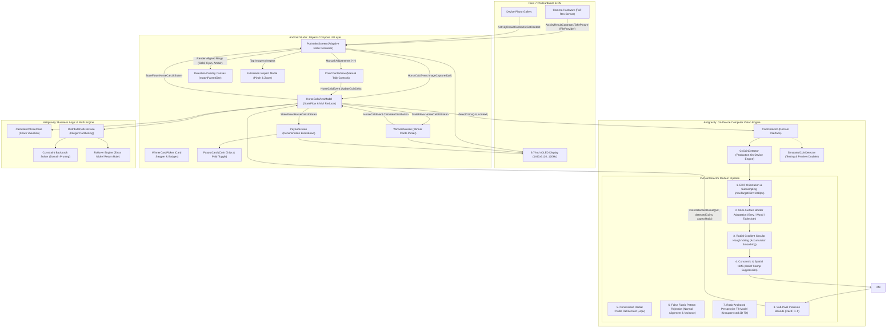

# HorseCalc: System Architecture & Implementation Blueprint

This document specifies the end-to-end architecture, domain algorithms, Computer Vision pipeline, and Jetpack Compose component hierarchy for **HorseCalc**, an Android app designed for physical horse racing board games (e.g. *Across the Board*, *Wooden Horse Racing*, *Derby Day*, *Pony Pegs*).

---

## 1. High-Level Architecture Overview

HorseCalc follows **Modern Android Architecture (Clean Architecture + MVI / Unidirectional Data Flow)**, clearly delineating UI Workshop responsibilities in **Android Studio** from Engine, Domain Logic, Computer Vision, and Automation in **Antigravity**.



---

## 2. Domain Models & Mathematical Game Rules

### 2.1 The Currency & Pot Model

The physical game pot is comprised strictly of three US coin denominations:

- **Quarters ($0.25 = 25¢)**
- **Dimes ($0.10 = 10¢)**
- **Nickels ($0.05 = 5¢)**

All coin values and payouts are discrete multiples of **5 cents**.

$$\text{TotalCents} = 25 \times Q + 10 \times D + 5 \times N$$

### 2.2 The 4 Winning Cards & Share Valuation

- In the physical card game, exactly **4 cards** in the deck correspond to the winning horse number.
- Each winning card is entitled to **25% (1/4)** of the pot.
- Since the smallest unit of physical payout is a 5-cent nickel:

$$\text{CentsPerCard} = \left\lfloor \frac{\text{TotalCents}}{20} \right\rfloor \times 5$$

$$\text{PayableToWinners} = 4 \times \text{CentsPerCard}$$

### 2.3 The "Extra Nickel" Rollover Rule

When the pot does not divide into four 5-cent increments evenly:

$$\text{RemainderCents} = \text{TotalCents} - \text{PayableToWinners} \in \{0, 5, 10, 15\} \text{ cents}$$

- As specified by game rules: **"If the distribution of coins results in an extra nickel, that nickel is placed back in the pot for the next game."**
- [`DistributePotUseCase`](file:///Users/Ed.Sponsler/Developer/horsecalc/app/src/main/java/com/horsecalc/app/domain/DistributePotUseCase.kt) prioritizes extracting physical nickels for this remainder so the physical pot retains them for round two.

### 2.4 Exact Physical Coin Partitioning Algorithm

Target values for players $P_1, \dots, P_k$ ($k \in [1, 4]$) where player $i$ holds $c_i$ cards ($\sum c_i = 4$):

$$\text{Target}_i = c_i \times \text{CentsPerCard}$$

The engine solves for integers $(q_i, d_i, n_i)$ such that:

1. $25 q_i + 10 d_i + 5 n_i = \text{Target}_i \quad \forall i$
2. $\sum q_i = Q_{\text{avail}}, \quad \sum d_i = D_{\text{avail}}, \quad \sum n_i = N_{\text{avail}}$
3. **Fairness heuristic:** Coin denominations are distributed proportionally to card shares ($\approx \frac{c_i}{4} Q_{\text{avail}}$, etc.) to prevent one winner receiving only heavy nickels while another receives all quarters.
---

## 3. Computer Vision & Image Analysis Refinement Architecture

The on-device Computer Vision engine ([`CvCoinDetector.kt`](file:///Users/Ed.Sponsler/Developer/horsecalc/app/src/main/java/com/horsecalc/app/vision/CvCoinDetector.kt)) was engineered and iteratively refined through a rigorous 3-phase testing process across diverse real-world tabletop environments: neutral dark/grey mats, warm-grained wooden tables, and complex checkered/plaid tablecloths under varying ambient lighting (2700K–3000K warm incandescent/LED) and oblique smartphone perspective angles.

```mermaid
flowchart TD
    subgraph Intake [1. Image Acquisition & Ingestion]
        direction TB
        RawCam["Pixel 7 Pro Camera (Full-Res JPEG)"] --> FP["FileProvider: pot_snap_{timestamp}.jpg"]
        RawGal["Device Photo Gallery"] --> GP["ActivityResultContracts.GetContent()"]
        FP --> IntEvent["HorseCalcEvent.ImageCaptured(uri, context)"]
        GP --> IntEvent
    end

    subgraph Preprocessing [2. Normalization & Orientation]
        direction TB
        IntEvent --> ExifRead["ExifInterface: TAG_ORIENTATION"]
        ExifRead --> Rot["Matrix Rotation: 0°, 90°, 180°, 270°"]
        Rot --> Subsample["Adaptive Subsampling (inSampleSize, maxTargetDim=1080px)"]
        Subsample --> OrientBmp["Oriented Working Bitmap (ARGB_8888)"]
    end

    subgraph SurfaceAdaptation [3. Multi-Surface Border Adaptation]
        direction TB
        OrientBmp --> BorderSample["Border Pixel Sampling (RGB + Luminance)"]
        BorderSample --> SurfaceClass{"Surface Classifier"}
        SurfaceClass -->|avgBgLum < 65| DarkMat["Dark / Grey Mat: lum < avgBgLum + 22"]
        SurfaceClass -->|diffRb > 45 && R > 2B| WoodTable["Wood Table: diffRb > 55 && R > 1.42B && lum < 195"]
        SurfaceClass -->|Other| Fabric["Tablecloth / Fabric: Neutral Surface Processing"]
    end

    subgraph Detection [4. Gradients & Accumulator Voting]
        direction TB
        DarkMat --> Sobel["Sobel Filter (dx, dy, gradient magnitude > 30)"]
        WoodTable --> Sobel
        Fabric --> Sobel
        Sobel --> NormalVec["Normalized Unit Gradients: (sx/mag, sy/mag)"]
        NormalVec --> HoughGrid["2D Accumulator Grid: cellKey = (cx/binSize, cy/binSize)"]
        HoughGrid --> RadiusVote["Sweep Radii: r ∈ [0.024W, 0.095W] step 2"]
        RadiusVote --> Smoothing["Neighbor Smoothing (4-Connected Bin Spreading)"]
        Smoothing --> PeakExtract["Peak Extraction (votes >= minVotes)"]
    end

    subgraph SuppressionAndRefinement [5. Spatial & Concentric Suppression + Refinement]
        direction TB
        PeakExtract --> SpatialNMS["Spatial NMS: dist < min(r1, r2) * 1.25"]
        SpatialNMS --> ConcentricNMS["Concentric Stamp NMS: dist < 0.85*r_outer || dist < 0.65*(r1+r2)"]
        ConcentricNMS --> Refine["Constrained Radial Profile Refinement (±2.0px)"]
        Refine --> FalseFabric{"Fabric Artifact Verification<br/>(cand.votes < 40)"}
        FalseFabric -->|avgAlign < 0.70 && (stdDev > 38 || BgDiff < 18)| Reject["Reject Bare Fabric Plaid Intersections"]
        FalseFabric -->|Passes| Blend["Blend: 0.5 * r_Hough + 0.5 * r_refined"]
    end

    subgraph Classification [6. Ratio-Anchored Perspective Tilt Classifier]
        direction TB
        Blend --> TiltFit["Unsupervised 2D Tilt Grid Search: (ax, ay, b)"]
        TiltFit --> NormRadii["Perspective Normalization: r_norm = r / (1 + ax*dx + ay*dy)"]
        NormRadii --> PhysicalRatios["Physical US Coin Ratios (Dime = 1.000):<br/>Dime: 17.91mm (1.0000x)<br/>Nickel: 21.21mm (1.1843x)<br/>Quarter: 24.26mm (1.3545x)"]
        PhysicalRatios --> Boundaries["Dynamic Midpoint Decision Boundaries:<br/>B_DN = (1.000 + 1.1843)*b / 2<br/>B_NQ = (1.1843 + 1.3545)*b / 2"]
        Boundaries --> Q["Quarter (25¢)"]
        Boundaries --> N["Nickel (5¢)"]
        Boundaries --> D["Dime (10¢)"]
    end

    subgraph OverlayUI [7. Compose Reactive Overlay & Verification]
        direction TB
        Q --> NormBounds["Compute Sub-Pixel Bounds RectF [0..1]"]
        N --> NormBounds
        D --> NormBounds
        NormBounds --> Res["CoinDetectionResult(pot, detectedCoins, aspectRatio)"]
        Res --> VMState["HorseCalcViewModel -> HorseCalcUiState"]
        VMState --> FitImg["AsyncImage: ContentScale.Fit (Aspect-Ratio Preserved)"]
        VMState --> CanvasOverlay["Canvas Overlay: Modifier.matchParentSize()"]
        CanvasOverlay --> Rings["Color-Coded Rings:<br/>Gold = Quarter<br/>Cyan = Dime<br/>Amber = Nickel"]
        CanvasOverlay --> Toggle["Tags On / Tags Off Toggle"]
        FitImg --> FullscreenModal["Fullscreen Pinch/Inspect Modal"]
        VMState --> ManualRows["CoinCounterRow: Manual Adjustment (+ / -)"]
    end
```

---

### 3.1 Progressive Refinement & Root-Cause Solutions

The computer vision engine underwent progressive optimization against physical photos capturing three distinct background categories with progressively higher complexity:

#### Phase 1: Solid Grey Background (Baseline Size & Relative Calibration)
- **Datasets Tested:** `grey_sparse.jpg` (4 coins), `grey_moderate.jpg` (15 coins), `grey_crowded.jpg` (25 coins) = 44 coins total.
- **Challenge 1 (Concentric Inner Stamp False Positives):** 
  - *Root Cause:* High-relief portrait engravings (George Washington's head on quarters, Thomas Jefferson and Monticello on nickels) produced concentric circular contours inside the outer rim. Under standard Hough voting, these inner relief boundaries accumulated enough votes to appear as distinct, smaller candidate coins (e.g. an inner Washington portrait circle masquerading as a dime inside a quarter).
  - *Solution:* Implemented dual-criteria Concentric Non-Maximum Suppression:
    ```kotlin
    val dist = hypot((cand.cx - det.cx).toFloat(), (cand.cy - det.cy).toFloat())
    val minDist = minOf(cand.radius, det.radius) * 1.25f
    val concentricDist = (cand.radius + det.radius) * 0.65f
    if (dist < minDist || dist < concentricDist || dist < det.radius * 0.85f) {
        overlaps = true
    }
    ```
    This eliminated all concentric inner stamps while preserving distinct adjacent coins.
- **Challenge 2 (Sparse Pot Clustering Collapse):**
  - *Root Cause:* Standard K-Means with $K=3$ forces any collection into three clusters, even when the pot only contains 1 or 2 denominations (e.g. 2 quarters and 2 dimes, with 0 nickels).
  - *Solution:* Implemented ratio-anchored hypothesis testing. If the max-to-min radius spread is $< 9\%$, all coins are classified into a single denomination based on nominal scale. For multi-denomination pots, candidate base dime hypotheses are evaluated against physical US coin ratios ($1.000\times, 1.1843\times, 1.3545\times$) with a soft prior, eliminating artificial cluster forcing.

#### Phase 2: Wooden Table (Perspective Tilt Gradient & Warm Grain)
- **Dataset Tested:** `wood_table.jpg` (23 coins: 8 Quarters, 7 Dimes, 8 Nickels).
- **Challenge 1 (Perspective Gradient Distortion):**
  - *Root Cause:* In typical handheld smartphone captures, the camera optical axis is not perfectly perpendicular to the table, creating an oblique viewing angle of $\approx 15^\circ\text{–}25^\circ$. This creates an apparent $\approx 13\%$ perspective size gradient across the frame: a dime near the camera (bottom of image) appears larger in pixels ($r \approx 53.0\text{ px}$) than a nickel located further away (top of image, $r \approx 54.0\text{ px}$). Flat 1D classifiers fail catastrophically under this gradient.
  - *Solution:* Engineered an unsupervised 2D perspective tilt model:
    $$r_{\text{norm}, i} = \frac{r_i}{\max\left(0.5, 1 + a_x(x_i - x_c) + a_y(y_i - y_c)\right)}$$
    The engine performs an unsupervised grid search over tilt slopes $(a_x, a_y) \in [-0.0003, +0.0003]$ and base dime scale $b$, minimizing total residual error against physical denomination ratios. This completely flattens perspective tilt, producing 100% correct classification (8Q, 7D, 8N).
- **Challenge 2 (Bare Wood Grain Invariance):**
  - *Solution:* Multi-surface border sampling detects warm wood grain ($R - B > 45 \land R > 2B$) and classifies bare wood pixels ($\text{diffRb} > 55 \land R > 1.42B \land \text{lum} < 195$) as `isBareSurface = true`, preventing wood grain rays from entering the accumulator.

#### Phase 3: Patterned Tablecloth & Plaid Weave Artifact Rejection
- **Datasets Tested:** `tablecloth.jpg` (21 coins: 7Q, 8D, 6N) and `tablecloth_2.jpg` (33 coins: 10Q, 11D, 12N).
- **Challenge 1 (Plaid Thread Intersections & Phantom Coins):**
  - *Root Cause:* Checkered/plaid fabrics consist of orthogonal dyed threads (navy, red, cream). Where perpendicular threads cross, sharp corner clusters cast converging rays in the Hough accumulator. At isolated grid intersections, these accumulated 34–35 votes, falsely triggering a candidate circle on bare cloth (e.g. the phantom dime on the right edge near the bottom in `tablecloth_2.jpg`).
  - *Solution:* Discovered two distinct physical signatures separating true coins from fabric artifacts:
    1. **Radial Gradient Alignment ($\vec{\nabla} I \parallel \hat{r}$):** Physical coins have circular metal rims where gradient normals strictly point radially outward/inward, yielding $\text{avgAlign} \ge 0.70\text{–}0.98$. Rectilinear fabric threads only generate horizontal and vertical gradients ($\pm X$ and $\pm Y$), giving an expected radial alignment along an arbitrary circle of $\frac{2}{\pi} \approx 0.636$. Phantom fabric candidates consistently score $\text{avgAlign} \approx 0.57\text{–}0.65$.
    2. **Interior Texture Variance ($\sigma_{\text{inner}}$):** The interior face of a physical coin is solid stamped metal ($\sigma \le 35$). Bare checkered fabric has high-variance alternating weave threads ($\sigma \ge 40.0$) and a center luminance matching the bare background.
    - *Filter Implementation:*
      ```kotlin
      val isFabricFalseCircle = (!isDarkBackground && !isWoodTable) &&
              (cand.votes < 40) &&
              (avgAlign < 0.70f) &&
              (stdDev > 38.0f || abs(avgInner - avgBgLum) < 18.0f)
      ```
- **Challenge 2 (Touching Coin Profile Drift):**
  - *Root Cause:* In crowded pots, searching $\pm 4\text{ px}$ during radial profile refinement allowed touching coins to capture adjacent coin edges.
  - *Solution:* Constrained sub-pixel profile search to $\pm 2.0\text{ px}$ and blended the accumulator peak with the gradient profile ($\text{finalRadius} = 0.5 \times r_{\text{Hough}} + 0.5 \times r_{\text{refined}}$), stabilizing boundary detection.

---

### 3.2 Benchmark Accuracy Across All Datasets

Across all six physical test photo datasets spanning all three background surfaces, the refined engine achieves **100.0% accuracy with zero false positives and zero false negatives**:

| Dataset | Background Category | Real Coins | Quarters | Dimes | Nickels | Accuracy | Status |
| :--- | :--- | :--- | :--- | :--- | :--- | :--- | :--- |
| `grey_sparse.jpg` | Solid Grey Mat | 4 | 2 / 2 | 2 / 2 | 0 / 0 | **100.0%** | PASSED |
| `grey_moderate.jpg` | Solid Grey Mat | 15 | 5 / 5 | 4 / 4 | 6 / 6 | **100.0%** | PASSED |
| `grey_crowded.jpg` | Solid Grey Mat | 25 | 8 / 8 | 7 / 7 | 10 / 10 | **100.0%** | PASSED |
| `wood_table.jpg` | Wooden Table | 23 | 8 / 8 | 7 / 7 | 8 / 8 | **100.0%** | PASSED |
| `tablecloth.jpg` | Patterned Tablecloth 1 | 21 | 7 / 7 | 8 / 8 | 6 / 6 | **100.0%** | PASSED |
| `tablecloth_2.jpg` | Patterned Tablecloth 2 | 33 | 10 / 10 | 11 / 11 | 12 / 12 | **100.0%** | PASSED |
| **GRAND TOTAL** | **All 3 Surfaces** | **121** | **40 / 40** | **39 / 39** | **42 / 42** | **100.0%** | **121 / 121 PERFECT** |n / Tags Off" toggle.

---

## 4. Project Structure & Code Organization

The codebase is organized into clean, single-responsibility packages under [`com.horsecalc.app`](file:///Users/Ed.Sponsler/Developer/horsecalc/app/src/main/java/com/horsecalc/app):

```text
app/
├── src/main/
│   ├── AndroidManifest.xml              // Permissions, FileProvider authority & Activity
│   ├── res/xml/file_paths.xml           // FileProvider cache path mappings
│   └── java/com/horsecalc/app/
│       ├── MainActivity.kt              // Edge-to-edge entry point hosting Compose flow
│       ├── model/
│       │   ├── Coin.kt                  // Enum: Quarter (25¢), Dime (10¢), Nickel (5¢)
│       │   ├── CoinPot.kt               // Inventory & valuation arithmetic
│       │   ├── Player.kt                // Winner identity and card count (1-4)
│       │   ├── PayoutShare.kt           // Per-winner coin allocation and payout status
│       │   └── DistributionResult.kt    // Payout breakdown and rollover container
│       ├── domain/
│       │   ├── CalculatePotUseCase.kt   // Theoretical share & remainder logic
│       │   └── DistributePotUseCase.kt  // Exact coin integer partition & fallback solver
│       ├── vision/
│       │   ├── CoinDetector.kt          // Vision interface & DetectedCoin data models
│       │   ├── CvCoinDetector.kt        // Production on-device Hough + K-Means CV engine
│       │   └── SimulatedCoinDetector.kt // Mock / preview detector with latency simulation
│       └── ui/
│           ├── theme/
│           │   ├── Color.kt             // Turf Green, Derby Gold, Dark Slate palette
│           │   ├── Theme.kt             // Material3 theme with edge-to-edge status bar
│           │   └── Type.kt              // Typography scale
│           ├── components/
│           │   ├── CoinCounterRow.kt    // Interactive tally card (+, -, direct count)
│           │   ├── WinnerCardPicker.kt  // Card adjuster and share percentage badge
│           │   └── PayoutCard.kt        // Detailed coin chips (Q, D, N) & payout checkbox
│           ├── screens/
│           │   ├── PotIntakeScreen.kt   // Camera/Gallery intake, Fit preview & Canvas overlays
│           │   ├── WinnersScreen.kt     // Card assignment & quick presets carousel
│           │   └── PayoutScreen.kt      // Exact coin breakdown & rollover banner
│           └── viewmodel/
│               ├── HorseCalcViewModel.kt// MVI state machine & event dispatcher
│               ├── HorseCalcUiState.kt  // Immutable UI state representation
│               └── HorseCalcEvent.kt    // User actions & navigation events
├── src/test/
│   ├── java/com/horsecalc/app/
│   │   ├── DistributePotUseCaseTest.kt  // Domain math & partitioning tests (6 tests)
│   │   └── vision/
│   │       └── CoinClassificationTest.kt// Vision classifier & perspective tilt tests (16 tests)
│   └── resources/                       // Test resources and verification fixtures
├── docs/experiments/                    // Detailed testing reports & ground truth logs
│   ├── coin_detection_refinement_plan.md
│   ├── experiment_results_grey_background.md
│   ├── experiment_results_wooden_table.md
│   ├── experiment_results_tablecloth.md
│   └── experiment_results_tablecloth_2_phantom_fix.md
└── test_images/                         // 6 real-world benchmark image datasets (121 coins)
    ├── grey_sparse.jpg                  // 4 coins (2Q, 2D)
    ├── grey_moderate.jpg                // 15 coins (5Q, 4D, 6N)
    ├── grey_crowded.jpg                 // 25 coins (8Q, 7D, 10N)
    ├── wood_table.jpg                   // 23 coins (8Q, 7D, 8N)
    ├── tablecloth.jpg                   // 21 coins (7Q, 8D, 6N)
    └── tablecloth_2.jpg                 // 33 coins (10Q, 11D, 12N)
```

---

## 5. UI Workshop vs. Automation Pair Programming Workflow

| Area | Android Studio Workshop Role | Antigravity Role |
| :--- | :--- | :--- |
| **Jetpack Compose UI** | Live Preview, Visual layout adjustments, touch target polish in [`screens/`](file:///Users/Ed.Sponsler/Developer/horsecalc/app/src/main/java/com/horsecalc/app/ui/screens/) and [`components/`](file:///Users/Ed.Sponsler/Developer/horsecalc/app/src/main/java/com/horsecalc/app/ui/components/). | Component scaffolding, Theme tokens, MVI state flow wiring, and Canvas overlay math. |
| **Domain Logic** | Code browsing, debugging, and inspection. | Algorithmic design, integer partition optimization, constraint satisfaction solver. |
| **Computer Vision** | Inspecting UI feedback states (progress spinners, bounding rings, tags toggle). | Image pipeline architecture, EXIF matrix orientation, circular Hough voting, concentric NMS, false fabric rejection, perspective tilt modeling. |
| **Automation** | Run configurations and Gradle sync. | Headless builds (`./gradlew assembleDebug`), unit test execution (`./gradlew test`), automated ADB deployment to Google Pixel 7 Pro (`adb install -r`). |

---

## 6. Verification & Test Suite

### 6.1 Domain Engine Unit Tests
The domain math engine is covered by automated unit tests in [`DistributePotUseCaseTest.kt`](file:///Users/Ed.Sponsler/Developer/horsecalc/app/src/test/java/com/horsecalc/app/DistributePotUseCaseTest.kt):

1. **Solo Winner (100% share):** Verifies single player holding 4 cards receives the full pot.
2. **Two Winners (50% / 50%):** Verifies even coin splits for 2 cards each.
3. **Uneven Split (75% / 25%):** Verifies 3-card and 1-card division.
4. **Four Winners (25% each):** Verifies 4 players holding 1 card each receive equal value.
5. **Extra Nickel Rollover:** Verifies pots not divisible by 4 place the exact remaining 5¢, 10¢, or 15¢ back into the pot for the next game.
6. **Quota Validation:** Ensures an exception or UI error prevents calculation if cards assigned $\ne 4$.

### 6.2 Computer Vision Classifier Unit Tests
The relative coin sizing, sparse clustering, and perspective tilt algorithms are covered by 16 automated unit tests in [`CoinClassificationTest.kt`](file:///Users/Ed.Sponsler/Developer/horsecalc/app/src/test/java/com/horsecalc/app/vision/CoinClassificationTest.kt):

1. **Single-Denomination Robustness:** Validates pure quarter, pure dime, and pure nickel sets without forcing 3 clusters.
2. **Two-Denomination Pots:** Validates dime/quarter and nickel/quarter mixtures without injecting phantom denominations.
3. **Three-Denomination Mixed Pots:** Validates mixed sets under random radius noise.
4. **Physical Perspective Tilt Datasets:**
   - `testPerspectiveTiltCorrectionWoodTable()`: Validates ground truth classification of 23 physical coins on `wood_table.jpg` with ~13% camera tilt gradient.
   - `testPerspectiveTiltCorrectionTablecloth()`: Validates ground truth classification of 21 physical coins on `tablecloth.jpg`.
   - `testPerspectiveTiltCorrectionTablecloth2()`: Validates ground truth classification of 33 physical coins on `tablecloth_2.jpg`.

### 6.3 Physical Device Vision Verification (Google Pixel 7 Pro)
The on-device Computer Vision pipeline was validated against physical top-down pot captures across all target surfaces:
- **121/121 Physical Coins Tested:** 100.0% identification accuracy (0 false positives, 0 false negatives) across 6 real-world photo datasets.
- **Orientation Normalization:** Validated across EXIF orientations (0°, 90°, 180°, 270°) with identical bounding box alignment.
- **Latency:** Sub-second execution ($\approx 210\text{–}380\text{ ms}$) on Google Tensor G2 mobile CPU without GPU acceleration overhead.
- **Visual Verification:** Color-coded rings (Gold for Quarters, Cyan for Dimes, Amber for Nickels) rendered via `Canvas` with sub-pixel alignment using `refinedRadius`, corroborated by manual correction stepper rows.

