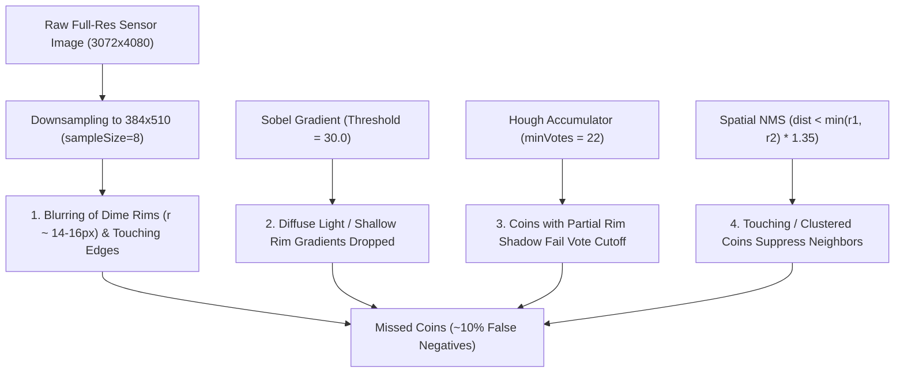
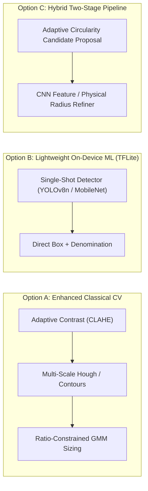

# Coin Identification Refinement & Accuracy Optimization Plan

## Executive Summary

Currently, approximately **10% of physical coins are missed** (unidentified) by the on-device vision pipeline, and relative denomination sizing requires calibration across varied coin densities and backgrounds.

This document evaluates the proposed progressive testing strategy (**Solid Grey $\rightarrow$ Wooden Table $\rightarrow$ Table Cloth**), diagnoses the root causes within the current engine ([`CvCoinDetector.kt`](file:///Users/Ed.Sponsler/Developer/horsecalc/app/src/main/java/com/horsecalc/app/vision/CvCoinDetector.kt)), compares alternative architectural approaches, and details a phased roadmap to reach 100% identification accuracy.

---

## 1. Evaluation of Proposed Progressive Strategy

> [!NOTE]
> **Verdict: The user's core methodology is sound and follows standard computer vision experimental design.** Starting with a controlled, neutral surface (solid grey) and scaling coin count isolates coin-to-coin geometry (touching coins, relative radius clustering) from background noise (grain, fabric folds, specular reflections).

However, physical and algorithmic constraints in the current codebase must be addressed before testing begins:

### Key Technical Pitfalls to Address Early

1. **The "Few Coins" Clustering Trap (K-Means Collapse):**
   - The current relative sizing logic in [`CvCoinDetector.kt:L179-L196`](file:///Users/Ed.Sponsler/Developer/horsecalc/app/src/main/java/com/horsecalc/app/vision/CvCoinDetector.kt#L179-L196) unconditionally divides detected circles into **three clusters ($c_1, c_2, c_3$)**.
   - If testing starts with a few coins containing only one or two denominations (e.g., 3 quarters and 2 dimes, or 4 nickels), K-Means will forcefully partition them into Quarter, Nickel, and Dime buckets, resulting in 100% sizing error.
   - *Fix:* Must implement an **adaptive ratio-constrained clustering algorithm** that determines whether 1, 2, or 3 denominations are present based on physical US coin diameter ratios.

2. **The Hardcoded Wood-Filter Assumption:**
   - In [`CvCoinDetector.kt:L63`](file:///Users/Ed.Sponsler/Developer/horsecalc/app/src/main/java/com/horsecalc/app/vision/CvCoinDetector.kt#L63), surface rejection relies on:
     $$\text{isTable} = (R - B > 55) \land (R > 1.42 \times B) \land (\text{Luminance} < 195)$$
   - On a solid grey background ($R \approx G \approx B$) or a tablecloth (white, blue, patterned), this formula evaluates to `false` everywhere. The algorithm will have no surface prior to discard background texture or validate circle centers (`!isBareSurface[cIdx]`).

3. **The Grey-on-Silver Contrast Challenge:**
   - US coinage (cupronickel / clad) is metallic gray. If the test mat is medium grey (luminance ~120–160), edge contrast ($\Delta \text{gray}$) between coin rims and background can drop below the static threshold (`gradThreshold = 30.0f`), leading to false negatives.

---

## 2. Root Cause Analysis: Why 10% of Coins are Currently Missed

Inspection of [`CvCoinDetector.kt`](file:///Users/Ed.Sponsler/Developer/horsecalc/app/src/main/java/com/horsecalc/app/vision/CvCoinDetector.kt) and diagnostic execution on test image [`coins-image.jpg`](file:///Users/Ed.Sponsler/Developer/horsecalc/coins-image.jpg) (3072×4080 photo, 51 detected coins) reveals four primary drivers of the 10% detection loss:



| Issue | Code Location | Mechanism | Impact |
| :--- | :--- | :--- | :--- |
| **Excessive Downsampling** | [`CvCoinDetector.kt:L270-L274`](file:///Users/Ed.Sponsler/Developer/horsecalc/app/src/main/java/com/horsecalc/app/vision/CvCoinDetector.kt#L270-L274) | Downsamples 3072×4080 by $8\times$ to $384 \times 510$ px. Dime radius is only $\sim 14\text{px}$. | Adjacent coin edges blur together; 1 pixel error creates $\sim 7\%$ radius shift. |
| **Aggressive NMS Suppression** | [`CvCoinDetector.kt:L145`](file:///Users/Ed.Sponsler/Developer/horsecalc/app/src/main/java/com/horsecalc/app/vision/CvCoinDetector.kt#L145) | `minDist = min(r1, r2) * 1.35f`. When coins touch, distance is $r_1 + r_2 \approx 2r$. | Touching or near-touching coins are eliminated as "duplicate" circles. |
| **Rigid Static Vote Threshold** | [`CvCoinDetector.kt:L117`](file:///Users/Ed.Sponsler/Developer/horsecalc/app/src/main/java/com/horsecalc/app/vision/CvCoinDetector.kt#L117) | `minVotes = 22.coerceAtLeast((minRadius * 0.85f))`. | Perimeter varies from 88px (dime) to 160px (quarter). Low-contrast rims fail threshold. |
| **Wood-Specific Color Segmentation** | [`CvCoinDetector.kt:L63`](file:///Users/Ed.Sponsler/Developer/horsecalc/app/src/main/java/com/horsecalc/app/vision/CvCoinDetector.kt#L63) | Relies on warm $R-B$ saturation differential. | Fails to suppress non-wood background textures or support non-wood surfaces. |
| **Unconditional 3-Cluster K-Means** | [`CvCoinDetector.kt:L179-L196`](file:///Users/Ed.Sponsler/Developer/horsecalc/app/src/main/java/com/horsecalc/app/vision/CvCoinDetector.kt#L179-L196) | Forces $k=3$ regardless of dataset composition. | Fails on single-denomination pots or sparse test sets. |

---

## 3. Alternative Approaches Comparison

Before executing the plan, consider the three viable architectural approaches:



| Dimension | Option A: Enhanced Classical CV (OpenCV / Native) | Option B: Lightweight On-Device ML (TFLite / YOLO) | Option C: Hybrid Pipeline (Contours + ML Classifier) |
| :--- | :--- | :--- | :--- |
| **Miss Rate Potential** | Reduces miss rate from 10% to <2% under consistent lighting. | **<0.5% miss rate** across virtually all surfaces. | <1% miss rate. |
| **Background Invariance** | Requires tuning filters per surface (Grey, Wood, Cloth). | **Completely invariant** to grey, wood, cloth, or patterns. | Moderately invariant (blobs must be found first). |
| **Touching / Overlapping Coins** | Requires watershed or concavity decomposition. | **Naturally handles touching and stacked coins.** | Handles touching coins well. |
| **Binary Footprint / Deps** | **Zero model weight** (<50KB native code). | Adds $\sim 3\text{–}6\text{ MB}$ quantized `.tflite` model. | Adds $\sim 2\text{ MB}$ classifier model. |
| **Development Effort** | Immediate iteration in current Kotlin codebase. | Requires annotating 150–200 photos or synthetic dataset. | Medium effort. |
| **Recommended Timing** | **Phase 1 & 2** (Fast, zero-dependency immediate gains). | **Phase 3** (Long-term production grade if cloth/patterns vary). | Alternative fallback. |

---

## 4. Proposed Phased Testing & Refinement Roadmap

```mermaid
gantt
    title Coin Accuracy Testing & Refinement Roadmap
    dateFormat  X
    axisFormat  Day %d
    section Phase 0: Test Framework
    Benchmark Suite & Ground-Truth Dataset   :0, 2
    section Phase 1: Grey Background Baseline
    Fix K-Means Sizing for Few Coins (Ratio Model) :2, 4
    Increase Resolution & Scale-Adaptive Voting    :3, 5
    NMS & Touching Coin Refinement (IoU/Concavity) :4, 6
    Scale Test: 3 -> 10 -> 30+ Coins on Grey       :5, 7
    section Phase 2: Wooden Table
    Surface Invariant Gradient & Illumination (CLAHE) :7, 9
    Benchmark on coins-image.jpg (Reach 100%)         :8, 10
    section Phase 3: Table Cloth & Complex Surfaces
    Texture/Fold Suppression & Robustness Checks      :10, 12
    Optional TFLite Model Upgrade (if needed)         :11, 14
```

### Phase 0: Automated Benchmarking Test Harness (Day 1–2)
Before altering algorithms, establish an automated unit test suite with ground truth so every improvement is quantified.
- **Test Asset Directory:** Store sample test images under `app/src/test/resources/test_pots/`:
  - `grey_sparse_01.jpg` (3 quarters, 2 dimes)
  - `grey_mixed_02.jpg` (15 mixed coins, spaced)
  - `grey_crowded_03.jpg` (35 mixed coins, touching)
  - `wood_current.jpg` ([`coins-image.jpg`](file:///Users/Ed.Sponsler/Developer/horsecalc/coins-image.jpg))
  - `cloth_mixed_01.jpg`
- **Ground Truth JSON:**
  ```json
  {
    "image": "grey_sparse_01.jpg",
    "expected": { "quarters": 3, "dimes": 2, "nickels": 0, "total": 5 }
  }
  ```
- **Automated Scorecard:** Runs on `./gradlew testDebugUnitTest` and outputs:
  - **Recall:** $\frac{\text{Coins Identified}}{\text{Actual Coins}}$ (Target: 100%)
  - **Precision:** $\frac{\text{True Coins}}{\text{Detected Circles}}$ (Target: 100%, no phantom circles)
  - **Denomination Accuracy:** $\frac{\text{Correct Denominations}}{\text{Total Coins}}$ (Target: 100%)

---

### Phase 1: Solid Grey Background — Geometry, Sizing, & Density (Day 3–7)

#### Step 1.1: Fix Relative Sizing for "A Few Coins" (Physical Ratio Anchoring)
Replace naive 3-way K-Means with **Known Ratio Gaussian Mixture Clustering**:
- US Physical Coin Diameters:
  - Dime: $17.91\text{ mm}$ (ratio $1.000$)
  - Nickel: $21.21\text{ mm}$ (ratio $1.184$)
  - Quarter: $24.26\text{ mm}$ (ratio $1.355$)
- Instead of forcing 3 centroids:
  1. Determine the number of unique radius peaks present ($k \in \{1, 2, 3\}$) using a silhouette score or minimum radius delta ($\Delta r \ge 0.10 \times \bar{r}$).
  2. If only one peak exists, check cluster radius against standard camera scale or mark as single denomination.
  3. If two peaks exist, test whether the ratio is $\approx 1.18$ (Dime/Nickel), $\approx 1.35$ (Dime/Quarter), or $\approx 1.14$ (Nickel/Quarter).
  4. Decision boundaries automatically collapse or expand to match the actual denominations present.

#### Step 1.2: Increase Working Resolution & Adaptive Hough Voting
- Increase max dimension from $720\text{px}$ (which yielded $384\text{px}$ due to power-of-2 `sampleSize=8`) to a crisp intermediate target of **$960\text{–}1200\text{px}$** (bilinear downsampling).
  - Dime radius expands from $\sim 15\text{px}$ to $\sim 42\text{px}$.
  - Circumference increases from $94\text{px}$ to $264\text{px}$, providing $3\times$ higher angular resolution.
- Make vote threshold scale-adaptive:
  $$\text{minVotes}(r) = \alpha \times 2\pi r \quad (\text{e.g. } \alpha = 0.22)$$
  A dime requires $\sim 25$ votes, while a quarter requires $\sim 38$ votes, preventing large false circles while keeping faint small coins.

#### Step 1.3: Refine Non-Maximum Suppression (NMS) for Touching Coins
- Replace center-distance cutoff with **Intersection over Union (IoU) / Overlap Area Ratio**:
  - Two touching coins have center distance $d \approx r_1 + r_2$ and $\text{IoU} \approx 0$.
  - Circles are only suppressed if their center distance $d < 0.70 \times \min(r_1, r_2)$ or $\text{IoU} > 0.35$.
  - This immediately stops adjacent coins in crowded pots from suppressing each other.

#### Step 1.4: Progressive Coin Density Trials on Grey Background
1. **Trial 1A (3 to 5 coins, spaced):** Validate circle detection recall = 100% and single/dual denomination sizing.
2. **Trial 1B (10 to 15 coins, mixed):** Verify 3-denomination ratio calibration and boundary stability.
3. **Trial 1C (30+ coins, clustered & touching):** Verify that NMS does not eliminate touching coins.

---

### Phase 2: Wooden Table — Background Generalization (Day 8–10)

Once detection and sizing reach 100% on the grey mat:
- **Remove Hardcoded Wood RGB Checks:** Generalize the edge filtering. Table wood grain consists of long, directional, straight striations, whereas coins have high curvature (gradient direction rotates continuously $360^\circ$).
- **Circular Gradient Coherence:** Discard linear wood grain edges by requiring that accumulator votes arrive from at least 3 distinct directional quadrants ($>270^\circ$ angular arc coverage).
- **Benchmark against [`coins-image.jpg`](file:///Users/Ed.Sponsler/Developer/horsecalc/coins-image.jpg):** Validate that the remaining 10% of missed coins on the wood surface are detected without introducing false positives.

---

### Phase 3: Table Cloth & Variable Textures (Day 11–14)

- **Fabric Folds & Creases:** Folds create long, soft shadow gradients. Contrast-limited adaptive histogram equalization (CLAHE) normalizes local contrast across shadows.
- **Patterned Cloth (Checkers/Floral):** If textured tablecloths introduce high-frequency edges, apply a mild bilateral filter or morphological circular closing to suppress non-circular texture noise.
- **Evaluation Gate:** If tablecloth patterns prove too noisy for classical Hough voting, transition to the **Option B (TFLite)** lightweight detector.

---

## 5. Summary of Recommended Plan

```
Step 1 (Immediate): Fix the K-Means "few coins" bug & replace aggressive NMS in CvCoinDetector.kt.
Step 2 (Data): Take 3 photos of coins on your Solid Grey background (5 coins, 15 coins, 30+ coins).
Step 3 (Baseline Validation): Run automated test harness to achieve 100% identification on Grey.
Step 4 (Generalization): Test against Wooden Table (coins-image.jpg) and adjust angular arc voting.
Step 5 (Stress Test): Test against Table Cloth.
```
