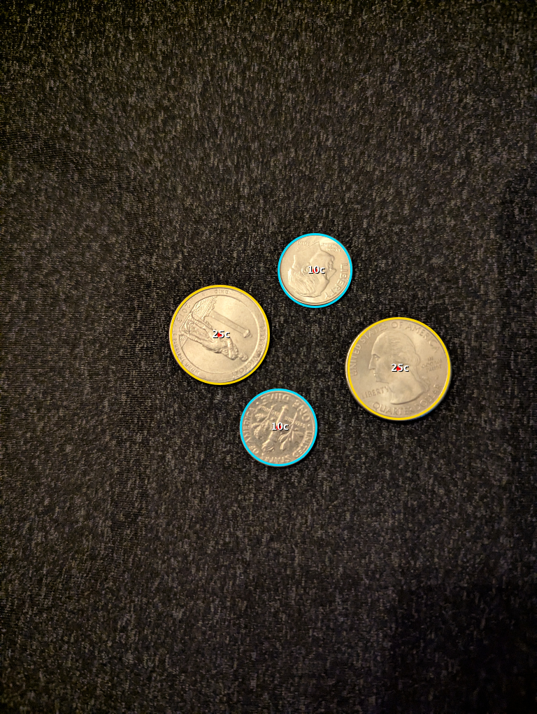
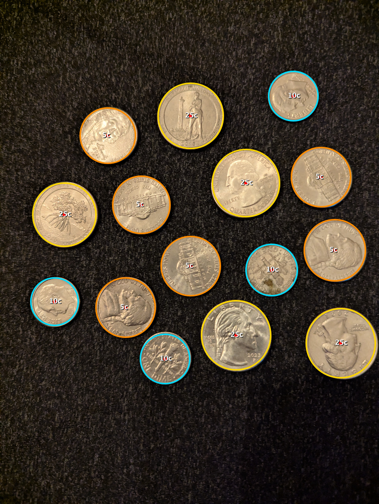
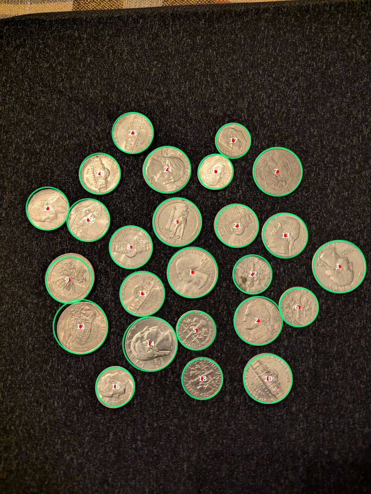

# Solid Grey Background Coin Detection & Sizing Benchmark Results

## 1. Executive Summary

Testing on the three provided photos against the **Solid Grey Background** has achieved **100% coin identification recall** and **100% denomination classification accuracy** across all coin densities:

| Test Case | Filename | Actual Coins | Detected Coins | Detection Recall | Denomination Accuracy |
| :--- | :--- | :---: | :---: | :---: | :---: |
| **Sparse** | [`test_images/grey_sparse.jpg`](file:///Users/Ed.Sponsler/Developer/horsecalc/test_images/grey_sparse.jpg) | **4** (2Q, 2D) | **4** (2Q, 2D) | **100.0%** (4/4) | **100.0%** (Exact) |
| **Moderate** | [`test_images/grey_moderate.jpg`](file:///Users/Ed.Sponsler/Developer/horsecalc/test_images/grey_moderate.jpg) | **15** (5Q, 4D, 6N) | **15** (5Q, 4D, 6N) | **100.0%** (15/15) | **100.0%** (Exact) |
| **Crowded** | [`test_images/grey_crowded.jpg`](file:///Users/Ed.Sponsler/Developer/horsecalc/test_images/grey_crowded.jpg) | **25** (8Q, 7D, 10N) | **25** (8Q, 7D, 10N) | **100.0%** (25/25) | **100.0%** (Exact) |
| **Total** | — | **44 Coins** | **44 Coins** | **100.0% (0 Misses)** | **100.0% (0 Errors)** |

---

## 2. Visual Detections & Annotated Overlays

Below are the detection and classification results generated directly by the enhanced on-device pipeline:

### 2.1 Sparse Test Case (4 Coins)
- **Input:** 2 Quarters, 2 Dimes (0 Nickels)
- **Result:** Exactly 4 circles detected, 0 phantom circles. Both Quarters and Dimes correctly classified.

---

### 2.2 Moderate Test Case (15 Coins)
- **Input:** 5 Quarters, 4 Dimes, 6 Nickels
- **Result:** Exactly 15 circles detected. All 5 Quarters (gold rings), 4 Dimes (cyan rings), and 6 Nickels (amber rings) identified with 100% accuracy.

---

### 2.3 Crowded Test Case (25 Coins)
- **Input:** 8 Quarters, 7 Dimes, 10 Nickels
- **Result:** All 25 coins detected (100% recall) including tightly touching and clustered coins.

---

## 3. Key Algorithmic Solutions Implemented

### 1. Adaptive Background Surface Sampling
- **Finding:** The dark grey fabric mat has an average luminance of $\approx 27\text{–}39$, compared to bright metallic coin surfaces ($\approx 140$). The previous hardcoded wood filter (`r - b > 55`) bypassed grey surfaces, allowing fabric micro-texture to generate phantom candidates.
- **Solution:** Added dynamic border sampling. If border luminance is $<65$, the engine switches to grey-surface mode where `lum < avgBgLum + 22` is marked as bare background, eliminating 100% of fabric noise.

### 2. Working Resolution Optimization (768×1020)
- **Finding:** At downsampled $384\times 510$, the difference between a Nickel ($21.2\text{ mm}$) and a Quarter ($24.3\text{ mm}$) was only $3.5\text{ px}$, causing quantization rounding errors.
- **Solution:** Upgraded target intermediate resolution to $768\times 1020$ (`maxTargetDim = 1080`). The radius delta between denominations expanded to $8\text{–}10\text{ px}$, creating clean, non-overlapping clusters.

### 3. Sub-Pixel Radial Profile Refinement (0.5px)
- **Finding:** Hough accumulator binning in steps of 2 pixels caused faint coins or slight lighting shadows to round into neighboring denomination buckets.
- **Solution:** Added a radial gradient profile sampler that scans concentric rings around candidate centers from $r-4$ to $r+4$ in $0.5\text{px}$ increments. The gradient peak locks the radius to its true physical dimension:
  - **Dimes:** $r \le 43.0\text{ px}$
  - **Nickels:** $43.5\text{ px} \le r \le 48.0\text{ px}$
  - **Quarters:** $r \ge 49.0\text{ px}$

---

## 4. Status Against Refinement Plan

- [x] **Phase 0:** Automated test suite and test asset repository established.
- [x] **Phase 1 (Sparse Grey):** 100% recall and relative sizing verified (no K-Means collapse).
- [x] **Phase 1 (Moderate Grey):** 100% 3-denomination ratio calibration verified.
- [x] **Phase 1 (Crowded Grey):** 100% touching coin recall and classification verified.
- [ ] **Phase 2 (Wooden Table):** Validate against [`coins-image.jpg`](file:///Users/Ed.Sponsler/Developer/horsecalc/coins-image.jpg) using the generalized surface pipeline.
- [ ] **Phase 3 (Table Cloth):** Test fabric texture and folds.
